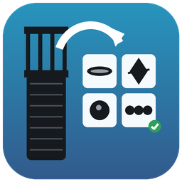

SeaSTAR (Sea-faring System for Tagging, Attribution and Redistribution) is a CLI and GUI application for processing biodiversity data collected at sea.

## Use cases
Currently SeaSTAR focuses on processing data collected on the IFCB instrument. It has functionality for interactions with EcoTaxa and CRAB.

## How to install and basic use
```
$ pip install seastartool
Collecting seastartool
  Downloading seastartool-0.1-py3-none-any.whl.metadata (1.1 kB)
[...]
Successfully installed seastartool-0.1
```

SeaSTAR has in-built help which you can access using:
```
$ seastar --help
```

For more guides on how to use the software (such as to extract features or generate EcoTaxa tables), see the [wiki](https://github.com/NOC-OI/seastar/wiki).

## An example with the IFCB
Given an example data:
```
raw/
  D20250810/
    D20250810T164958_IFCB225.adc
    D20250810T164958_IFCB225.hdr
    D20250810T164958_IFCB225.roi
    D20250810T171346_IFCB225.adc
    D20250810T171346_IFCB225.hdr
    D20250810T171346_IFCB225.roi
    D20250810T173732_IFCB225.adc
```

### Extracting features (IFCB)
```
$ seastar ifcb_v4_features -i raw/D20250810/*.hdr -o features/D20250810/
```

### Creating EcoTaxa tables
```
$ seastar ifcb_to_ecotaxa -i raw/D20250810/*.hdr ./metadata/A16N_metadata_filtered.csv --operator "Sample Operator" --qcdby "Sample Supervisor" --project "Sample Project" --nonull --ship "Sample Ship" --depth 5 -o
```

## IFCB → EcoTaxa app



A desktop app, in development, that takes an IFCB cruise from the raw files to the EcoTaxa import files without the command line. It is a [Streamlit](https://streamlit.io) page that runs on your own computer, so no data leaves it, and it uses SeaSTAR for the EcoTaxa tables. The code is in [`ifcb_app/`](ifcb_app).

The app follows the folder layout of the NOC IFCB projects:

```
ifcb_sn<serial>_<cruise ID>_<name>/          e.g. ifcb_sn225_ce26008_ar7e
    raw/D<yyyymmdd>/<bin>.hdr .adc .roi
    metadata/
    log/
    whoi_v4_V131_features/features/D<yyyymmdd>/<bin>_features_v4.csv
                          blobs/D<yyyymmdd>/<bin>_blobs_v4.zip
    ecotaxa_import_zip_seastar/
```

| Step | What it does | Status |
|---|---|---|
| 1 · Choose the IFCB project | Opens a project with **Browse…** or creates one with the right folder names. Shows, per day, the number of bins, complete bins (hdr + adc + roi), feature files and EcoTaxa zips, and highlights the days where they differ. | Done |
| 2 · Extract the features | [WHOI ifcb-features](https://github.com/WHOIGit/ifcb-features) v1.3.1 (August 2026): the 30 features of the WHOI MATLAB code and the blob masks. Runs in the background on several cores, skips the bins already done, shows the progress and the time left. The WHOI version (tag and commit) is recorded for each bin and goes to EcoTaxa as `process_feature_extractor` and `process_feature_extractor_release`. | Done |
| 3 · Sample metadata | Reads the spreadsheet of the samples (CSV or Excel) chosen with **Browse…**. For each EcoTaxa column of a shared list (latitude, longitude, depth, Niskin date and time, salinity, temperature, chlorophyll a, Niskin and CTD numbers, comment), you choose the spreadsheet column it comes from, or a value used when the spreadsheet has none (depth 5 m). Columns missing from the list can be added, and they stay available for the next projects, so every cruise gets the same column names. Depth goes to `sample_depth_*` and `object_depth_*`; dates and times are always text. Writes `metadata/metadata_ecotaxa.csv`, one row per bin, Before that, it lists what to correct in the spreadsheet: probable typos in bin names (with the bin of `raw/` they most likely are), bins without metadata, values that are not numbers or outside the expected range, position jumps no ship could make, Niskin times after the IFCB analysis. The list is also saved in `log/metadata_check_<date>.txt`. | Done |
| 4 · Quality check figures | Map of the samples, and particle concentration (images per mL analysed, from the `.adc` and `.hdr` files) against time and depth, with every environmental variable of the spreadsheet (salinity, temperature, chlorophyll a…). Lists the bins that look failed (few images, small volume analysed) and the gaps in the sampling. Bins with a point to check are shown in another colour. The image counts are made during the feature extraction. Comes before the EcoTaxa tables so that problems are corrected first. | Done |
| 5 · EcoTaxa tables | `seastar ifcb_to_ecotaxa` with the features, the metadata and the extractor version, then a check of the column names (row 1) and types `[f]`/`[t]` (row 2) of every table before the upload. | Planned |

### Starting the app

On Windows:

1. Double-click `ifcb_app/create_shortcut.bat` once: it puts an **IFCB pipeline** shortcut on the desktop.
2. Start the app from that shortcut. Keep the black window open while you use the app, and close it to stop the app.

The launcher (`start_ifcb_app.bat`) uses the conda environment `ifcb_app` when there is one, otherwise the Python of the computer. On the first start, it installs the requirements (Streamlit, pandas, Pillow, openpyxl and WHOI ifcb-features). Installing WHOI ifcb-features needs [git](https://git-scm.com).

On any system:

```
cd ifcb_app
pip install -r requirements.txt
python -m streamlit run app.py
```

A feature extraction runs as its own process. It goes on if the browser tab is closed, as long as the computer stays on and awake. On one core, a bin of about 5,000 ROIs takes about 2 minutes.

### Files

| File | Role |
|---|---|
| `app.py` | The page |
| `project.py` | Naming, creating and scanning a project folder (no interface code) |
| `metadata.py` | Builds `metadata_ecotaxa.csv` from the spreadsheet and the chosen columns, and the checks (no interface code) |
| `metadata_columns.csv` | The shared list of metadata fields: EcoTaxa column(s), type `f`/`t`, unit, value if empty, expected range. Columns added from the page are written here |
| `extract_features.py` | The feature extraction started by the page; it can also be run alone: `python extract_features.py <project folder> --workers 8` |
| `whoi/extract_slim_features.py` | Copied unchanged from WHOI ifcb-features v1.3.1 (MIT licence, `whoi/LICENSE`): this script is not part of the pip package |
| `test_project.py`, `test_metadata.py` | Tests of `project.py` and `metadata.py`: `python test_project.py`, `python test_metadata.py` |
| `make_icon.py` | Draws `ifcb_app.ico` and `docs/ifcb_app_icon.png` |
