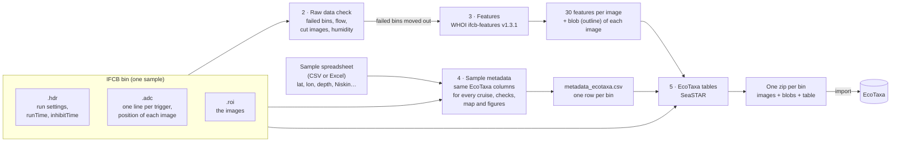
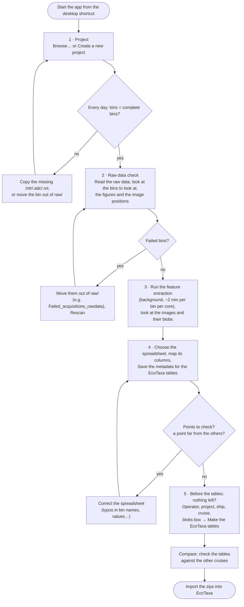
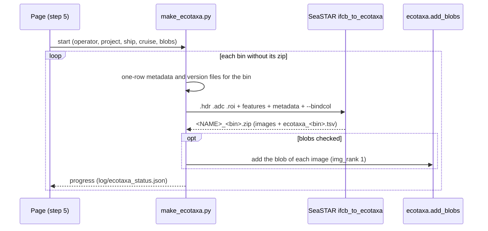
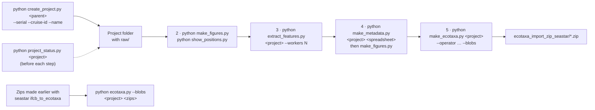

# IFCB → EcoTaxa processing protocol

How to take the data of one Imaging FlowCytobot (IFCB) cruise from the raw files to the files imported into
EcoTaxa, at the National Oceanography Centre. It covers the two ways of working:

- **the app** (Windows, in the web browser): every step, with the checks and the figures;
- **the command line** (Python): every step too, with the same checks and figures, for scripts or for a remote machine.

Tools: the IFCB → EcoTaxa app (`ifcb_app/` in [amandaelineau-stack/seastar](https://github.com/amandaelineau-stack/seastar)),
[WHOI ifcb-features](https://github.com/WHOIGit/ifcb-features) v1.3.1 for the features, and SeaSTAR
([NOC-OI/seastar](https://github.com/NOC-OI/seastar), `all-fixes` branch of the fork until the open pull requests
are merged) for the EcoTaxa tables.

---

## 1. What the pipeline does



| Step | What it does | App (menu Process) | Command line |
|---|---|---|---|
| 1 · Project | Creates or opens the project folder; per day, bins, features and zips; where each step stands | ✅ | `create_project.py`, `project_status.py` |
| 2 · Raw data check | From the `.adc` and `.hdr` only: images and volume of each bin, failed bins, gaps, the instrument (images per trigger, stream of particles, cut images, humidity), the position of the images of a bin | ✅ | `make_figures.py`, `show_positions.py` |
| 3 · Features | Measures 30 morphological features of every image and saves its blob (WHOI MATLAB-compatible); images above their blobs | ✅ | `extract_features.py`, `show_blobs.py` |
| 4 · Sample metadata | Turns the sample spreadsheet into `metadata_ecotaxa.csv`, with the shared EcoTaxa column names, lists the errors; map and environmental values against time and depth | ✅ | `make_metadata.py`, then `make_figures.py` |
| 5 · EcoTaxa tables | What is still to check, then one zip per bin with images, blobs, features, metadata and versions | ✅ | `make_ecotaxa.py` |
| Compare | Compares the column names and types of the EcoTaxa tables of several projects | ✅ | Python one-liner |

The raw data are checked before the features, so that no time is spent extracting bins that failed. The app and the
scripts use the same code and write the same files, so a project can be started in one and finished in the other.
On the command line nobody looks at the column choices of step 4 before they are used: the script prints them, so
read them, and read the checks it prints before step 5.

In the app, the menu on the left has three groups: **Process** (steps 1 to 5 and Compare), **EcoTaxa API** and
**BODC** (to come). The icon of each step tells where it stands: ✅ done, ⚠️ something to look at, ☐ to do, ⏳ running.

---

## 2. The project folder

One folder per cruise and instrument, named `ifcb_sn<serial>_<cruise ID>_<name>`, e.g. `Y:\ifcb_sn225_ce26008_ar7e`.

```
ifcb_sn225_ce26008_ar7e/
├── raw/D<yyyymmdd>/<bin>.hdr .adc .roi        the IFCB files, as copied from the instrument
├── metadata/
│   ├── <your spreadsheet>.csv / .xlsx         the sample spreadsheet (one row per bin)
│   ├── metadata_ecotaxa.csv                   written by step 4
│   └── metadata_ecotaxa.json                  its column types and the choices made
├── whoi_v4_V131_features/
│   ├── features/D<yyyymmdd>/<bin>_features_v4.csv        (+ multiblob/)
│   ├── blobs/D<yyyymmdd>/<bin>_blobs_v4.zip
│   └── feature_extractor_versions.csv        WHOI version used for each bin
├── figures/                                  quality check figures (PNG), steps 2 and 4
├── ecotaxa_import_zip_seastar/<NAME>_<bin>.zip   the files to import into EcoTaxa, step 5
└── log/                                      what each run did (see section 7)
```

A bin is named `D<yyyymmdd>T<hhmmss>_IFCB<serial>`, the time the IFCB started analysing it (UTC). It needs its
three files. Failed acquisitions and bead runs should be moved out of `raw/` (for example to
`Failed_acquisitions_rawdata/` and `raw_beads/`) before step 3: step 2 helps to find them.

---

## 3. Before you start

### App (Windows)

1. Install [git](https://git-scm.com) and Python 3.10 or newer (or Miniconda).
2. Get the code: `git clone https://github.com/amandaelineau-stack/seastar.git`.
3. Double-click `seastar\ifcb_app\create_shortcut.bat` once: an **IFCB pipeline** shortcut appears on the desktop.
4. Start the app from the shortcut. On the first start, the launcher installs the requirements (a few minutes).
   Keep the black window open while you use the app; close it to stop the app.

### Command line (Windows, Linux or WSL)

```bash
git clone https://github.com/amandaelineau-stack/seastar.git
cd seastar/ifcb_app
pip install -r requirements.txt        # in a conda environment or a venv
```

Run the scripts from `seastar/ifcb_app`. Each script prints its help with `--help`.

---

## 4. Protocol with the app



One page per step, in the menu on the left (group **Process**). The project chosen in step 1 stays chosen on the
other pages; each page shows it at the top, with a **Rescan** button.

### Step 1 · Project

- **Existing project:** *Open an existing project* → **Browse…** → the project folder. The title turns green when
  the folder has all the standard sub-folders; otherwise click **Create the missing folders**.
- **New cruise:** *Create a new project* → serial number (e.g. `225`), cruise ID (`ce26008`), name (`ar7e`), the
  folder that holds the projects (`Y:\`) → **Create project**. Then copy the IFCB day folders into `raw/`.
- **Where the project stands**: one line per step, with its icon and what is left; click a step to open it.
- Check the table per day: the numbers of **bins** and **complete bins** must be equal. Days where the numbers differ
  are highlighted. After copying new data, click **Rescan the project**.

### Step 2 · Raw data check

- Click **Read the raw data** if the page asks: it reads the `.adc` and `.hdr` of the bins not read yet (about 25 s
  per bin on the network drive; the feature extraction also reads them). A bar shows the bins read and the time
  left. It is saved every 20 bins: if the page is left, the next run goes on from there.
- Read the list of the bins to look at (the checks are in section 6 below; *What each check means* on the page).
  **Move the failed acquisitions out of `raw/`** (e.g. to `Failed_acquisitions_rawdata/`) and click **Rescan**, so
  that step 3 does not spend time on them.
- Look at the figures against time: concentration in images mL⁻¹, images per trigger, position and width of the
  stream of particles, images cut at the edge of the camera field, humidity. **In each figure, only the bins flagged
  for a reason that figure shows are coloured, and the legend names the reason** (a bin with several reasons takes
  the colour of the main one). Hover a point: *to check* lists every reason of the bin. Drag to pan, Shift + mouse
  wheel to zoom, double-click to go back.
- Look at **Position of the images in the camera field** (ROI x against ROI y of one bin; the flagged bins first):
  the images should form one compact band. Spread out or moved, the flow is bad (blocked needle, pump); orange images
  touch the left or right edge and are cut.

### Step 3 · Features

- The page shows the WHOI version installed (e.g. `v1.3.1 (commit 1d0687e)`) and tells you when WHOI has
  published a newer release. Keep one version for the whole cruise.
- **Bins**: *All bins, skipping those already extracted* (the default), or *Chosen days or bins, done again* to pick days and bins
  whose features are extracted again (for example a bin that failed).
- Choose the number of cores (leave one or two free) → **Run the feature extraction**.
- The extraction runs in its own process: you can close the tab, but the computer must stay on and awake. The
  progress bar and **Stop** come back when you reopen the page. Bins already done are skipped, so a stopped
  run can simply be started again.
- Then look at **Images and their blobs**: the blob should cover the particle, not the background or a bubble.

### Step 4 · Sample metadata

1. **Browse…** → the sample spreadsheet (CSV or Excel; choose the sheet). It needs one row per bin and a column
   with the bin name; the app finds that column.
2. In the table, for each EcoTaxa field, choose **From spreadsheet column**, and if needed a value **If empty**
   (5 m for the depth of the underway intake). The app proposes columns whose names look like the field.
3. Read the **points to check** (also in `log/metadata_check_<date>.txt` once written):

| Check | What to do |
|---|---|
| Bin name typo? | Correct the bin name in the spreadsheet: the app gives the bin of `raw/` it most likely is |
| Bin without metadata | Add its row, or accept the values *If empty* |
| Bin not in raw/ | A row for a bin that does not exist: remove it or find the bin |
| Not a number / Out of range | Correct the value (ranges are in `metadata_columns.csv`) |
| Position jump | A latitude or longitude typo, or a Niskin sample without its Niskin date and time |
| Niskin after analysis | The Niskin date or time is wrong |
| Same bin in several rows | Keep one row |

4. **Save the metadata for the EcoTaxa tables.** Nothing is saved before this click: the page only shows the
   preview and the checks. It writes `metadata/metadata_ecotaxa.csv`, which step 5 puts in the EcoTaxa tables.
   Correct the spreadsheet and choose it again until the list is empty or explained, and click again after each
   correction.

Rules applied to every cruise:

- Depth: 5 m by default, the spreadsheet value wins; written to `sample_depth_min/max` **and**
  `object_depth_min/max`.
- `object_date/time` and `sample_date/time`: the time the IFCB analysed the bin (from its name). The Niskin
  sampling time goes to `sample_niskin_date/time`. Dates and times are always text `[t]`.
- A measurement not in the list: **Add an EcoTaxa column to the list** (name starting with `sample_`, type,
  unit, expected range). It stays available for the next projects.

Then, on the same page, **Map and figures**: the map, and the particle concentration and every numeric field against
time and depth. As in step 2, a point is coloured only in the figures that show its problem, with the reason in the
legend (e.g. *Out of range* in the salinity, *Position jump* on the map). A point far from the others is often a typo.
The figures of steps 2 and 4 are saved in `figures/` automatically.

### Step 5 · EcoTaxa tables

- **Before the tables** lists the warnings (bins left out, no metadata, runs that failed) and every bin still
  flagged in steps 2 and 4, with its reasons. Correct what can be corrected first.
- Type once: **Operator** and **Metadata checked by** (full names, at least 5 characters), **Project**
  (`sample_project`, e.g. `ce26008_AR7E`), **Ship**, **Cruise**. They are remembered for the project.
- Keep **Add the blob of each image as a second image (img_rank 1)** checked, unless blobs are not wanted.
- **Bins**: *All bins, skipping those that already have their EcoTaxa zip* (the default), or *Chosen days or bins, done again*, for example the bins
  whose row of the spreadsheet was corrected (save the metadata of step 4 again first). The new zip replaces the old one only once
  it is complete.
- **Make the EcoTaxa tables.** It runs in the background like step 3. Zips already made are skipped, unless chosen.
- Before SeaSTAR, each feature file is checked: a `roi_number` column and one row per image. A bin that fails gets
  no zip and is listed with the reason: extract its features again. (SeaSTAR itself would make a zip without any
  feature: [issue #19](https://github.com/NOC-OI/seastar/issues/19).)



Each object of the EcoTaxa table has two rows when blobs are added: the image (`img_rank` 0) and its blob
(`img_rank` 1), with the same `object_id` and the same values.


Each object of the EcoTaxa table has two rows when blobs are added: the image (`img_rank` 0) and its blob
(`img_rank` 1), with the same `object_id` and the same values.

### Compare EcoTaxa tables

Menu on the left, group Process → **Compare EcoTaxa tables** → folder of the projects (`Y:\`) → choose the projects →
**Compare**. The text report lists, for each project, the number of tables and of different column sets, the
columns not present in every project, and the columns whose type (`[f]`/`[t]`) differs. **Download the report**
keeps it as a `.txt` file. Run it before importing a new cruise, to see whether its tables match the others.

---

## 5. Protocol on the command line



### Create the project

```bash
python create_project.py Y:\ --serial 225 --cruise-id jc278 --name pap2025new
```

- Creates `Y:\ifcb_sn225_jc278_pap2025new\` with the standard folders (section 2). If the project already exists, only
  its missing folders are created; nothing already there is changed.
- Then copy the day folders (`DYYYYMMDD`) of the IFCB into `raw/`.

### Where the project stands

```bash
python project_status.py Y:\ifcb_sn225_jc278_pap2025new
```

- Writes nothing. Prints, per day, the bins in `raw/`, the complete bins (`.hdr` + `.adc` + `.roi`), the feature
  files and the EcoTaxa zips; days where they differ are marked with `<` (the table of step 1 in the app).
- Then the same warnings as the app: bins missing a file (they are left out), bins without features, no metadata
  file, points still to check in the last metadata and bins checks, last runs that failed or stopped, a WHOI
  version different from the last extraction or a newer WHOI release. Run it before each step.
- `extract_features.py` and `make_ecotaxa.py` print the warnings of their step before they start, then one line per
  bin, then the failed bins.

### Raw data check (step 2)

```bash
python make_figures.py Y:\ifcb_sn225_jc278_pap2025new
```

- Saves the map and the figures as PNG in `figures/`, and the bins that look failed and the gaps in the sampling in
  `log/bins_check_<date>.txt`; prints the list.
- Reads the `.adc` and `.hdr` of the bins not read yet (slow on Y:\; the feature extraction also reads them). Before
  the metadata, it plots the concentration and the instrument values only; run it again after step 4 for the map
  and the environmental values. Move the failed bins out of `raw/` before step 3.
- As in the app, each figure colours only the bins flagged for a reason it shows, with the reason in the legend (the
  metadata points come from the last `log/metadata_check_<date>.txt`).

### Position of the images in the camera field

```bash
python show_positions.py Y:\ifcb_sn225_jc278_pap2025new
python show_positions.py Y:\ifcb_sn225_jc278_pap2025new D20250810T164958_IFCB225 D20250811
```

- ROI x against ROI y of every image of a bin, in `figures/positions_<bin>.png`. Without a bin: the bins flagged
  *Stream shifted*, *Stream wide* or *Many cut images*.

### Features (step 3)

```bash
python extract_features.py Y:\ifcb_sn225_jc278_pap2025new --workers 14
```

- Skips the bins that already have a feature file; safe to run again after a stop.
- One bin or one day at a time: `--bins D20250810T164958_IFCB225 D20250811` does only those bins (a day = all its
  bins), even if they already have features: the new files replace the old ones. A name that is not in `raw/` stops
  the script before anything is done, with the closest bin names.
- Prints one line per bin and the failed bins at the end; the same lines go to `log/features_<date>.log`.

### Images and their blobs

```bash
python show_blobs.py Y:\ifcb_sn225_jc278_pap2025new D20250810T164958_IFCB225 --seed 1
```

- Saves 12 images of the bin above their blob in `figures/blobs_<bin>_seed<seed>.png` and opens it. Check that each
  blob covers the particle, not the background or a bubble.
- Without a bin, shows the first bin with blobs and gives the range of bins. `--seed 2`, `3`… picks other images,
  `--n 18` shows more. All images have the same scale, so their sizes can be compared.

### Sample metadata (step 4)

```bash
python make_metadata.py Y:\ifcb_sn225_jc278_pap2025new Y:\ifcb_sn225_jc278_pap2025new\metadata\jc278_metadata.xlsx --check-only
```

- Prints which spreadsheet column fills each EcoTaxa field, then the points to check (the same checks as the app).
  `--check-only` writes nothing: correct the spreadsheet and run it again until the list is empty or explained.
- The columns come from, in this order: `--map FIELD=COLUMN` and `--default FIELD=VALUE`; the choices saved by the
  app or an earlier run for the same spreadsheet; the columns whose names look like the field. For example
  `--map depth_min="Depth (m)" --map depth_max="Depth (m)" --default depth_min=5`. `--map chla=` leaves a field out.
- Without `--check-only`, writes `metadata/metadata_ecotaxa.csv` and `log/metadata_check_<date>.txt`.
- `--sheet NAME` for an Excel sheet other than the first, `--bin-column COLUMN` if the bin names are not found.
  Without a spreadsheet path, it uses the one of the last run.
- A value that is not in the list of fields yet (e.g. oxygen): add it with
  `--add-field FIELD:COLUMN:TYPE[:UNIT[:MIN[:MAX[:DEFAULT[:DESCRIPTION]]]]]` and map it in the same command:
  `--add-field oxygen:sample_oxygen:f:umol/kg:0:500 --map oxygen="O2 (umol/kg)"`. TYPE is `f` (number) or `t` (text);
  the EcoTaxa column starts with `sample_`, `object_`, `acq_` or `process_`; MIN and MAX are the expected range (out of
  it = a point to check). The field goes into `ifcb_app/metadata_columns.csv`, the list shared by every project (also
  with `--check-only`), and a number field gets its own QC figures. Running the same command again adds nothing.
- Then run `python make_figures.py <project>` again: the map and the environmental values against time and
  depth, with the metadata points coloured.

### EcoTaxa zips (step 5)

After the metadata file (step 4):

```bash
python make_ecotaxa.py Y:\ifcb_sn225_jc278_pap2025new ^
    --operator "Full Name" --qcdby "Full Name" ^
    --project-name jc278_PAP2025 --ship "RRS James Cook" --cruise jc278 ^
    --blobs --workers 8
```

(`^` continues the line in the Windows command prompt; use `\` in bash.)

- Without `--blobs`, the zips have no blobs.
- Skips the bins that already have their zip; a failed bin leaves no zip. Each feature file is checked first (a
  `roi_number` column, one row per image): a bin that fails is listed, with no zip.
- One bin or one day at a time: `--bins …`, as for the features. The bins are made again even if they have their
  zip; the new zip replaces the old one only once it is complete, so a failure keeps the old zip. For example, after
  correcting one row of the spreadsheet: `make_metadata.py` (all the project, a few seconds), then
  `make_ecotaxa.py … --bins <that bin>`.
- Prints one line per bin and the failed bins at the end; the same lines go to `log/ecotaxa_<date>.log`.

### Blobs for zips made with SeaSTAR directly

```bash
python ecotaxa.py --blobs Y:\ifcb_sn225_ce26008_ar7e "Y:\ifcb_sn225_ce26008_ar7e\ecotaxa_import_zip_seastar\*.zip"
```

Adds the blobs to each zip; a zip that already has its blobs is left as it is.

### Compare EcoTaxa tables

```bash
python -c "import ecotaxa; p='Y:/'; print(ecotaxa.compare_report({n: ecotaxa.table_headers(p + n) for n in ['ifcb_sn225_ce26008_ar7e', 'ifcb_sn225_jc278_pap2025']}))"
```

---

## 6. Checks and what they mean

| Where | Check | Usual cause |
|---|---|---|
| 1, `project_status.py` | Bins ≠ complete bins | A file missing in `raw/` |
| 1, 5, `project_status.py` | Bins without features / without zip | A step not run yet, or bins that failed |
| 4 | Bin name typo? | A digit typed wrong or two digits swapped in the spreadsheet |
| 4 | Position jump (> 20 knots) | A lat/lon typo, or Niskin samples analysed in batches without their Niskin time |
| 4 | Out of range | A typo (salinity 350 for 35.0), or a unit error |
| 2 | Few images (< 10 % of the cruise median) | A failed acquisition |
| 2 | Small volume analysed (< 50 % of the median) | A run stopped early |
| 2 | Gap in the sampling | Instrument stopped, or bins missing from `raw/` |
| 2 | Short run (< 1000 s and < 2.5 mL) | An incomplete sample |
| 2 | Few images per trigger (< 0.9) | Triggers without an image: images lost |
| 2 | High humidity (above the alarm threshold of the `.hdr`, 90 %) | Water inside the IFCB |
| 2 | Stream shifted (median ROI y > 50 px, or 4 × the usual spread, from the cruise median) | Flow deviated |
| 2 | Stream wide (ROI y 10–90 % range > 1.5 × the cruise median) | Bad flow: blocked needle, pump |
| 2 | Many cut images (> 5 % and > 3 × the cruise median touch the left or right edge) | Flow near the edge, or long chains |
| 3 | Blob not on the particle | Segmentation problem: check focus and the image |
| Compare | Columns or types differ between cruises | Tables made with different tools or versions |

The instrument checks follow what IFCB users already look at: the RoiXY graph of the acquisition software
IFCBacquire and its "Bad flow, ROIs appear spread out over large area" issue in the
[IFCB field guide](https://github.com/mrun0205/IFCB_FieldGuide) (sections 6 and 8); the ROI x / ROI y plot shown by
default for each bin by the [WHOI IFCB dashboard](https://github.com/WHOIGit/ifcbdb); the
[QC script of the California IFCB network](https://github.com/NTrautman/IFCB) (ROIy against ROIx per sample, images
per trigger < 0.9, run < 1000 s and < 2.5 mL, humidity). [iRfcb](https://github.com/EuropeanIFCBGroup/iRfcb)
(`ifcb_qc_sample`) and [ifcbkit](https://github.com/WHOIGit/ifcbkit) ≥ 0.4 (`ifcbkit.qc`) check the integrity of the
files.

---

## 7. What is written where

| File | Written by | Content |
|---|---|---|
| `whoi_v4_V131_features/…` | step 3 | features, blobs, WHOI version per bin |
| `log/features_<date>.log`, `log/features_status.json` | step 3 | each bin done or failed |
| `log/bin_stats.csv` | step 2 (or 3) | images, mL analysed and concentration per bin |
| `metadata/metadata_ecotaxa.csv` / `.json` | step 4 | metadata with the EcoTaxa names, types and choices |
| `log/metadata_check_<date>.txt` | step 4 | the points to check, with their spreadsheet rows |
| `figures/qc_*.png` | steps 2 and 4 | map and figures |
| `figures/blobs_<bin>_seed<n>.png` | `show_blobs.py` | images above their blobs |
| `ecotaxa_import_zip_seastar/<NAME>_<bin>.zip` | step 5 | the files to import into EcoTaxa |
| `log/ecotaxa_<date>.log`, `log/ecotaxa_settings.json` | step 5 | each zip done or failed, the names typed |

In EcoTaxa, `process_feature_extractor` (e.g. `whoi_v4_release131`) and `process_feature_extractor_release`
(e.g. `v1.3.1 (commit 1d0687e)`) say which WHOI version measured the features.

---

## 8. When something goes wrong

| Symptom | What to do |
|---|---|
| The page is slow or a button stays grey | The network drive is slow: wait for the first reading; then **Rescan the project** only when needed |
| "WHOI ifcb-features is not installed" / "SeaSTAR is not installed" | Close the app and start it again from the shortcut: the launcher installs them (git is needed) |
| The extraction or the zips stopped | Run again: what is done is skipped |
| A bin failed in step 3 or 5 | Read its line in the log; often a damaged or incomplete bin: move it out of `raw/` |
| Wrong metadata in a zip already made | Correct the spreadsheet, write the metadata file again, delete that zip, make the tables again |
| The figures are not saved | The page still works; `vl-convert` is missing: start the app again from the shortcut |
