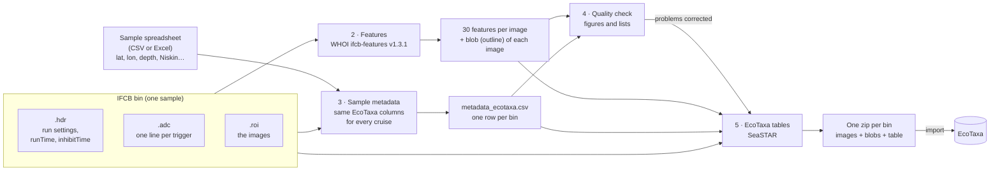
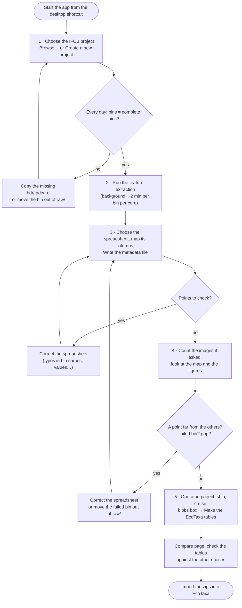
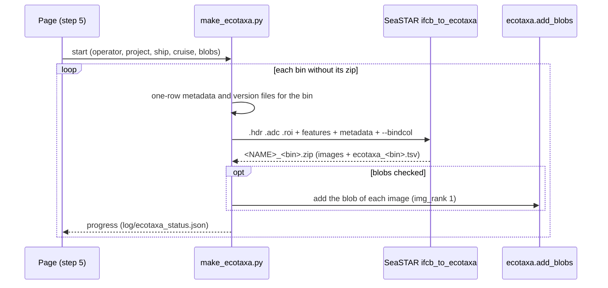
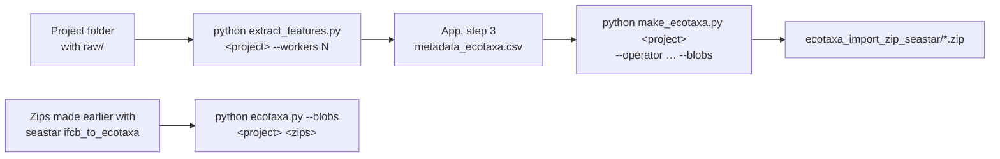

# IFCB → EcoTaxa processing protocol

How to take the data of one Imaging FlowCytobot (IFCB) cruise from the raw files to the files imported into
EcoTaxa, at the National Oceanography Centre. It covers the two ways of working:

- **the app** (Windows, in the web browser): every step, with the checks and the figures;
- **the command line**: the long steps (features, EcoTaxa zips, blobs), for scripts or for a remote machine.

Tools: the IFCB → EcoTaxa app (`ifcb_app/` in [amandaelineau-stack/seastar](https://github.com/amandaelineau-stack/seastar)),
[WHOI ifcb-features](https://github.com/WHOIGit/ifcb-features) v1.3.1 for the features, and SeaSTAR
([NOC-OI/seastar](https://github.com/NOC-OI/seastar), `all-fixes` branch of the fork until the open pull requests
are merged) for the EcoTaxa tables.

---

## 1. What the pipeline does



| Step | What it does | App | Command line |
|---|---|---|---|
| 1 · Project | Creates or opens the project folder, counts bins, features and zips per day | ✅ | folders by hand |
| 2 · Features | Measures 30 morphological features of every image and saves its blob (WHOI MATLAB-compatible) | ✅ | `extract_features.py` |
| 3 · Sample metadata | Turns the sample spreadsheet into `metadata_ecotaxa.csv`, with the shared EcoTaxa column names, and lists the errors | ✅ | — (app only) |
| 4 · Quality check | Map, particle concentration and environmental values against time and depth, failed bins, sampling gaps | ✅ | — (app only) |
| 5 · EcoTaxa tables | One zip per bin with images, blobs, features, metadata and versions | ✅ | `make_ecotaxa.py` |
| Compare | Compares the column names and types of the EcoTaxa tables of several projects | ✅ (second page) | Python one-liner |

Steps 3 and 4 need a person to choose and check: they are only in the app. A command-line run of step 5 uses the
metadata file written by the app in step 3.

---

## 2. The project folder

One folder per cruise and instrument, named `ifcb_sn<serial>_<cruise ID>_<name>`, e.g. `Y:\ifcb_sn225_ce26008_ar7e`.

```
ifcb_sn225_ce26008_ar7e/
├── raw/D<yyyymmdd>/<bin>.hdr .adc .roi        the IFCB files, as copied from the instrument
├── metadata/
│   ├── <your spreadsheet>.csv / .xlsx         the sample spreadsheet (one row per bin)
│   ├── metadata_ecotaxa.csv                   written by step 3
│   └── metadata_ecotaxa.json                  its column types and the choices made
├── whoi_v4_V131_features/
│   ├── features/D<yyyymmdd>/<bin>_features_v4.csv        (+ multiblob/)
│   ├── blobs/D<yyyymmdd>/<bin>_blobs_v4.zip
│   └── feature_extractor_versions.csv        WHOI version used for each bin
├── figures/                                  quality check figures (PNG), step 4
├── ecotaxa_import_zip_seastar/<NAME>_<bin>.zip   the files to import into EcoTaxa, step 5
└── log/                                      what each run did (see section 7)
```

A bin is named `D<yyyymmdd>T<hhmmss>_IFCB<serial>`, the time the IFCB started analysing it (UTC). It needs its
three files. Failed acquisitions and bead runs should be moved out of `raw/` (for example to
`Failed_acquisitions_rawdata/` and `raw_beads/`) before step 2.

---

## 3. Before you start

### App (Windows)

1. Install [git](https://git-scm.com) and Python 3.10 or newer (or Miniconda).
2. Get the code: `git clone https://github.com/amandaelineau-stack/seastar.git`.
3. Double-click `seastar\ifcb_app\create_shortcut.bat` once: an **IFCB pipeline** shortcut appears on the desktop.
4. Start the app from the shortcut. On the first start, the launcher installs the requirements (a few minutes).
   Keep the black window open while you use the app; close it to stop the app.

### Command line (Windows, Linux or WSL)

```bash
git clone https://github.com/amandaelineau-stack/seastar.git
cd seastar/ifcb_app
pip install -r requirements.txt        # in a conda environment or a venv
```

Run the scripts from `seastar/ifcb_app`. Each script prints its help with `--help`.

---

## 4. Protocol with the app



### Step 1 · Choose the IFCB project

- **Existing project:** *Open an existing project* → **Browse…** → the project folder. The title turns green when
  the folder has all the standard sub-folders; otherwise click **Create the missing folders**.
- **New cruise:** *Create a new project* → serial number (e.g. `225`), cruise ID (`ce26008`), name (`ar7e`), the
  folder that holds the projects (`Y:\`) → **Create project**. Then copy the IFCB day folders into `raw/`.
- Check the table: for each day, the numbers of **bins** and **complete bins** must be equal. Days where the
  numbers differ are highlighted.
- After copying new data, click **Rescan the project**.

### Step 2 · Extract the features

- The page shows the WHOI version installed (e.g. `v1.3.1 (commit 1d0687e)`) and tells you when WHOI has
  published a newer release. Keep one version for the whole cruise.
- Choose the number of cores (leave one or two free) → **Run the feature extraction**.
- The extraction runs in its own process: you can close the tab, but the computer must stay on and awake. The
  progress bar and **Stop** come back when you reopen the project. Bins already done are skipped, so a stopped
  run can simply be started again.
- It also counts the images and the volume analysed of each bin (for step 4).

### Step 3 · Sample metadata

1. **Browse…** → the sample spreadsheet (CSV or Excel; choose the sheet). It needs one row per bin and a column
   with the bin name; the app finds that column.
2. In the table, for each EcoTaxa field, choose **From spreadsheet column**, and if needed a value **If empty**
   (5 m for the depth of the underway intake). The app proposes columns whose names look like the field.
3. Read the **points to check** (also in `log/metadata_check_<date>.txt` once written):

| Check | What to do |
|---|---|
| Bin name typo? | Correct the bin name in the spreadsheet: the app gives the bin of `raw/` it most likely is |
| Bin without metadata | Add its row, or accept the values *If empty* |
| Bin not in raw/ | A row for a bin that does not exist: remove it or find the bin |
| Not a number / Out of range | Correct the value (ranges are in `metadata_columns.csv`) |
| Position jump | A latitude or longitude typo, or a Niskin sample without its Niskin date and time |
| Niskin after analysis | The Niskin date or time is wrong |
| Same bin in several rows | Keep one row |

4. **Write the metadata file.** Correct the spreadsheet and choose it again until the list is empty or explained.

Rules applied to every cruise:

- Depth: 5 m by default, the spreadsheet value wins; written to `sample_depth_min/max` **and**
  `object_depth_min/max`.
- `object_date/time` and `sample_date/time`: the time the IFCB analysed the bin (from its name). The Niskin
  sampling time goes to `sample_niskin_date/time`. Dates and times are always text `[t]`.
- A measurement not in the list: **Add an EcoTaxa column to the list** (name starting with `sample_`, type,
  unit, expected range). It stays available for the next projects.

### Step 4 · Quality check figures

- Click **Count the images** if the page asks (only for bins extracted before the counts existed; slow on the
  network drive).
- Look at the lists: **Few images** and **Small volume analysed** (failed acquisitions?), **Gap in the sampling**.
- Look at the map and the figures (concentration in images mL⁻¹ and every numeric field, against time and
  depth). Orange points have a point to check. A point far from the others is often a typo.
- Look at **Images and their blobs**: the blob should cover the particle, not the background or a bubble.
- The figures are saved in `figures/` automatically.

### Step 5 · EcoTaxa tables

- Type once: **Operator** and **Metadata checked by** (full names, at least 5 characters), **Project**
  (`sample_project`, e.g. `ce26008_AR7E`), **Ship**, **Cruise**. They are remembered for the project.
- Keep **Add the blob of each image as a second image (img_rank 1)** checked, unless blobs are not wanted.
- **Make the EcoTaxa tables.** It runs in the background like step 2. Zips already made are skipped: delete a
  zip to make it again (for example after correcting its metadata).



Each object of the EcoTaxa table has two rows when blobs are added: the image (`img_rank` 0) and its blob
(`img_rank` 1), with the same `object_id` and the same values.

### Compare EcoTaxa tables (second page)

Menu on the left → **Compare EcoTaxa tables** → folder of the projects (`Y:\`) → choose the projects →
**Compare**. The text report lists, for each project, the number of tables and of different column sets, the
columns not present in every project, and the columns whose type (`[f]`/`[t]`) differs. **Download the report**
keeps it as a `.txt` file. Run it before importing a new cruise, to see whether its tables match the others.

---

## 5. Protocol on the command line



### Features

```bash
python extract_features.py Y:\ifcb_sn225_jc278_pap2025new --workers 14
```

- Skips the bins that already have a feature file; safe to run again after a stop.
- Progress: `log/features_status.json`, details: `log/features_<date>.log`.

### EcoTaxa zips

Write the metadata file with the app (step 3) first, then:

```bash
python make_ecotaxa.py Y:\ifcb_sn225_jc278_pap2025new ^
    --operator "Full Name" --qcdby "Full Name" ^
    --project-name jc278_PAP2025 --ship "RRS James Cook" --cruise jc278 ^
    --blobs --workers 8
```

(`^` continues the line in the Windows command prompt; use `\` in bash.)

- Without `--blobs`, the zips have no blobs.
- Skips the bins that already have their zip; a failed bin leaves no zip.
- Progress: `log/ecotaxa_status.json`, details: `log/ecotaxa_<date>.log`.

### Blobs for zips made with SeaSTAR directly

```bash
python ecotaxa.py --blobs Y:\ifcb_sn225_ce26008_ar7e "Y:\ifcb_sn225_ce26008_ar7e\ecotaxa_import_zip_seastar\*.zip"
```

Adds the blobs to each zip; a zip that already has its blobs is left as it is.

### Compare EcoTaxa tables

```bash
python -c "import ecotaxa; p='Y:/'; print(ecotaxa.compare_report({n: ecotaxa.table_headers(p + n) for n in ['ifcb_sn225_ce26008_ar7e', 'ifcb_sn225_jc278_pap2025']}))"
```

---

## 6. Checks and what they mean

| Where | Check | Usual cause |
|---|---|---|
| 1 | Bins ≠ complete bins | A file missing in `raw/` |
| 3 | Bin name typo? | A digit typed wrong or two digits swapped in the spreadsheet |
| 3 | Position jump (> 20 knots) | A lat/lon typo, or Niskin samples analysed in batches without their Niskin time |
| 3 | Out of range | A typo (salinity 350 for 35.0), or a unit error |
| 4 | Few images (< 10 % of the cruise median) | A failed acquisition |
| 4 | Small volume analysed (< 50 % of the median) | A run stopped early |
| 4 | Gap in the sampling | Instrument stopped, or bins missing from `raw/` |
| 4 | Blob not on the particle | Segmentation problem: check focus and the image |
| Compare | Columns or types differ between cruises | Tables made with different tools or versions |

---

## 7. What is written where

| File | Written by | Content |
|---|---|---|
| `whoi_v4_V131_features/…` | step 2 | features, blobs, WHOI version per bin |
| `log/features_<date>.log`, `log/features_status.json` | step 2 | each bin done or failed |
| `log/bin_stats.csv` | step 2 or 4 | images, mL analysed and concentration per bin |
| `metadata/metadata_ecotaxa.csv` / `.json` | step 3 | metadata with the EcoTaxa names, types and choices |
| `log/metadata_check_<date>.txt` | step 3 | the points to check, with their spreadsheet rows |
| `figures/qc_*.png` | step 4 | map and figures |
| `ecotaxa_import_zip_seastar/<NAME>_<bin>.zip` | step 5 | the files to import into EcoTaxa |
| `log/ecotaxa_<date>.log`, `log/ecotaxa_settings.json` | step 5 | each zip done or failed, the names typed |

In EcoTaxa, `process_feature_extractor` (e.g. `whoi_v4_release131`) and `process_feature_extractor_release`
(e.g. `v1.3.1 (commit 1d0687e)`) say which WHOI version measured the features.

---

## 8. When something goes wrong

| Symptom | What to do |
|---|---|
| The page is slow or a button stays grey | The network drive is slow: wait for the first reading; then **Rescan the project** only when needed |
| "WHOI ifcb-features is not installed" / "SeaSTAR is not installed" | Close the app and start it again from the shortcut: the launcher installs them (git is needed) |
| The extraction or the zips stopped | Run again: what is done is skipped |
| A bin failed in step 2 or 5 | Read its line in the log; often a damaged or incomplete bin: move it out of `raw/` |
| Wrong metadata in a zip already made | Correct the spreadsheet, write the metadata file again, delete that zip, make the tables again |
| The figures are not saved | The page still works; `vl-convert` is missing: start the app again from the shortcut |
